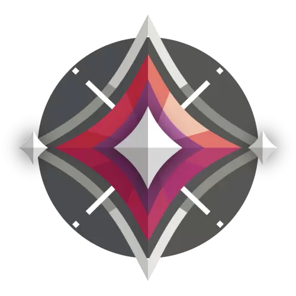
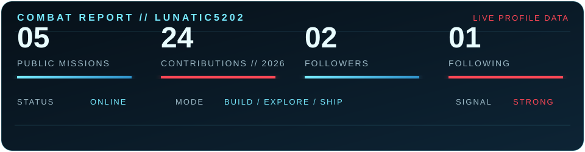
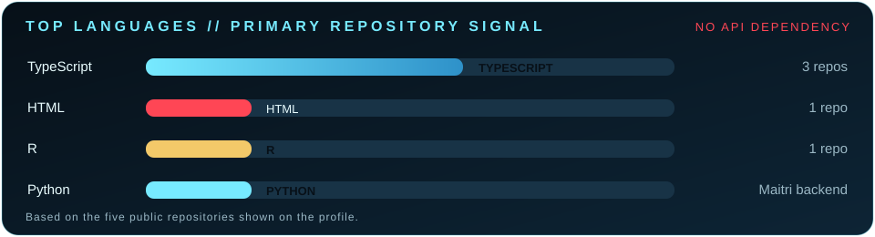
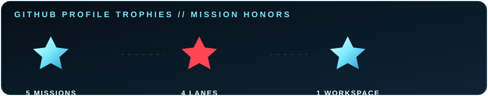

<div align="center">


<br />


<br />



<h1>LUNATIC5202</h1>

<p><strong>LUNATIC LAYMAN</strong> &nbsp; // &nbsp; CREATIVE DEVELOPER &nbsp; // &nbsp; DIGITAL WINDKEEPER</p>

<p>
  <a href="https://github.com/Lunatic5202?tab=repositories"></a>
  <a href="https://github.com/Lunatic5202"></a>
  <a href="https://github.com/Lunatic5202"></a>
</p>

</div>

---

<table>
<tr>
<td width="58%" valign="top">

## `// IDENTITY PROTOCOL`

> **I build interfaces that feel alive, explore data until it tells a story, and prototype ideas before they have time to get boring.**

My work sits at the intersection of **front-end craft, AI/ML experiments, data exploration, and cinematic UI**. I enjoy turning ambitious concepts into experiences that are clear, expressive, and impossible to ignore.

```txt
CALLSIGN       Lunatic Layman
HANDLE         Lunatic5202
SPECIALTY      Interfaces / Data / AI experiments
PLAYSTYLE      Fast iterations, sharp visuals, zero hesitation
CURRENT STATE  Shipping
```

</td>
<td width="42%" valign="top" align="center">

## `// RANK LOADOUT`


<p><strong>IMMORTAL // TIER III</strong><br />
<sub>Rank loadout</sub></p>


</td>
</tr>
</table>

## `// ACTIVE ABILITIES`

<div align="center">

| ABILITY | EFFECT |
|:---:|:---|
| **Q // UPDRAFT** | Turns rough ideas into working prototypes before the doubt can catch up. |
| **E // TAILWIND** | Moves quickly through TypeScript, React, Vite, and responsive UI systems. |
| **C // CLOUDBURST** | Creates atmosphere with motion, contrast, detail, and unexpected visual direction. |
| **X // BLADE STORM** | Combines data, AI experiments, and polished interfaces into one decisive release. |

</div>

## `// FEATURED MISSIONS`

<table>
<tr>
<td width="50%" valign="top">

### [MAITRI](https://github.com/Lunatic5202/Maitri)

**Audio emotion detection.** A full-stack experiment with a FastAPI backend, Vite + React frontend, lightweight NumPy preprocessing, and a `/classify` audio endpoint.

  

</td>
<td width="50%" valign="top">

### [DRISHTI MISSION CONSOLE](https://github.com/Lunatic5202/drishti-mission-cosmos)

**A simulated exoplanet control room.** A cinematic dashboard moving from raw photometry to signal processing, AI classification, model fitting, MCMC exploration, and final verdict.

  

</td>
</tr>
<tr>
<td width="50%" valign="top">

### [JOURNEY TO DISCOVER](https://github.com/Lunatic5202/Journey-To-Discover)

**Google reviews, hidden gems, and Indian travel data.** An analytical project exploring popularity, ratings, budgets, zones, and why underrated places deserve another look.

  

</td>
<td width="50%" valign="top">

### [STYLE-IN-STORE](https://github.com/Lunatic5202/style-in-store)

**A modern storefront interface.** A TypeScript/React build focused on component-driven UI, fast iteration, and a clean visual system.

  

</td>
</tr>
</table>

<div align="center">

<a href="https://github.com/Lunatic5202/bt--projects"></a>

</div>

## `// TECH LOADOUT`

<div align="center">


<br /><br />


</div>

## `// COMBAT TELEMETRY`

<div align="center">



<br />



<br />



</div>

## `// JETT COMMS`

> “Wind, show me where to go.”
>
> “Just let them try to catch me.”
>
> “Race you to the spike sites!”
>
> “Be faster.”

<sub>Selected Jett voice lines from <a href="https://vinagaming.com/voice-lines/jett-valorant-voice-lines/">VinaGaming’s Jett Valorant voice-line page</a> <a href="#references">[1]</a>.</sub>

## `// NEXT ROUND`

I am currently exploring more ways to make **data-heavy products feel cinematic**, **AI experiments feel approachable**, and **interfaces feel like places rather than pages**. If that sounds like your kind of build, send a transmission through [GitHub](https://github.com/Lunatic5202).

<div align="center">


<br />

</div>

---

<div align="center">
  
  
  
  
</div>

<div align="center">
  <sub>UPDRAFT &nbsp; // &nbsp; TAILWIND &nbsp; // &nbsp; CLOUDBURST &nbsp; // &nbsp; BLADE STORM</sub>
</div>

<!--
  INSTALL NOTES
  1. Copy README.md and the assets/ folder into the Lunatic5202/Lunatic5202 profile repository.
  2. Keep the relative asset paths unchanged.
  3. The supplied video is converted to assets/jett-hero.gif for GitHub-compatible looping playback.
  4. The Immortal icon is the actual rank artwork sourced from the VALORANT Wiki.
  5. The lower telemetry panels are local SVGs so they render without third-party widget downtime.
  6. The four ability icons are cropped from the supplied PNG and placed side by side.
-->

## `// REFERENCES`

[1]: https://vinagaming.com/voice-lines/jett-valorant-voice-lines/ "Jett Valorant Voice Lines — VinaGaming"
[2]: https://wiki.playvalorant.com/en-us/File:Immortal_3_Rank.png "Immortal 3 Rank.png — VALORANT Wiki"
