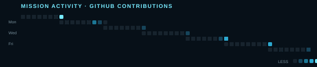

 

 

##

<strong>LUNATIC LAYMAN</strong> &nbsp; // &nbsp; CREATIVE DEVELOPER &nbsp; // &nbsp; DIGITAL WINDKEEPER

  <a href="https://github.com/Lunatic5202?tab=repositories">10 PUBLIC MISSIONS</a>
  &nbsp;·&nbsp;
  <a href="https://github.com/Lunatic5202">IMMORTAL LOADOUT</a>
  &nbsp;·&nbsp;
  <a href="https://github.com/Lunatic5202">BUILDING IN PUBLIC</a>

I build interfaces that feel alive, turn messy signals into useful decisions, and prototype ambitious ideas before they have time to get boring. My work now spans **AI-assisted products, computer vision, data exploration, full-stack systems, interactive fiction, and cinematic UI**.

## FEATURED MISSIONS

 

 

 

 

SELECT A MISSION TO OPEN THE REPOSITORY

<strong>01 / <a href="https://github.com/Lunatic5202/MediQueue">MEDIQUEUE</a></strong> &nbsp;  
AI early-warning and dynamic triage system for emergency departments, with LightGBM risk scoring, audited recommendations, and a FastAPI + React dashboard.

<strong>02 / <a href="https://github.com/Lunatic5202/Twice-told-tale">TWICE-TOLD TALE</a></strong> &nbsp;  
A branching 30-day otome visual novel built with Ren'Py, four acts, ten endings, and a persistent gallery.

<strong>03 / <a href="https://github.com/Lunatic5202/Job-Application-Tracker">CAREERX</a></strong> &nbsp;  
AI-powered career platform with a React + Vite + TypeScript frontend and FastAPI + MongoDB backend for resumes, jobs, applications, and scoring.

<strong>04 / <a href="https://github.com/Lunatic5202/Carbonex">CARBONEX</a></strong> &nbsp;  
Smart India Hackathon concept for mine-subsidence monitoring using ESP32, LoRa mesh telemetry, anomaly detection, GIS mapping, and early warnings.

<strong>05 / <a href="https://github.com/Lunatic5202/Attendance-tracker">ATTENDANCE TRACKER</a></strong> &nbsp;  
Face-recognition attendance system with SFace embeddings, shift and field-visit modes, admin controls, encrypted data, and a kiosk workflow.

<strong>06 / <a href="https://github.com/Lunatic5202/Maitri">MAITRI</a></strong> &nbsp;  
Real-time audio emotion detection using Python, FastAPI, React, Vite, and NumPy.

<strong>07 / <a href="https://github.com/Lunatic5202/drishti-mission-cosmos">DRISHTI MISSION CONSOLE</a></strong> &nbsp;  
ISRO-inspired mission control for photometry, AI classification, model fitting, and MCMC exploration.

<strong>08 / <a href="https://github.com/Lunatic5202/Journey-To-Discover">JOURNEY TO DISCOVER</a></strong> &nbsp;  
India travel analytics built with R, Shiny, and RMarkdown.

<strong>09 / <a href="https://github.com/Lunatic5202/style-in-store">STYLE-IN-STORE</a></strong> &nbsp;  
Component-driven storefront interface built with TypeScript, React, Vite, and Tailwind.

<strong>10 / <a href="https://github.com/Lunatic5202/bt--projects">BT--PROJECTS</a></strong> &nbsp;  
Active workspace for experiments, prototypes, and the next mission.

## TECH LOADOUT

## COMBAT TELEMETRY

 
<a href="https://github.com/Lunatic5202?tab=repositories">REPOSITORIES</a>
&nbsp;&nbsp;·&nbsp;&nbsp;
<a href="https://github.com/Lunatic5202?tab=overview">CONTRIBUTIONS</a>
&nbsp;&nbsp;·&nbsp;&nbsp;
<a href="https://github.com/Lunatic5202">PROFILE</a>

## OPERATOR STATS

 

## NEXT ROUND

I am exploring ways to make **clinical signals easier to act on**, **computer vision more practical**, **data-heavy products feel cinematic**, and **interfaces feel like places rather than pages**.

---

&nbsp;&nbsp;&nbsp;&nbsp;

&nbsp;&nbsp;&nbsp;&nbsp;

&nbsp;&nbsp;&nbsp;&nbsp;

