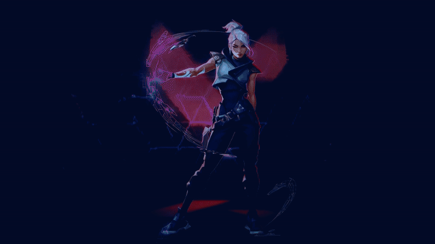
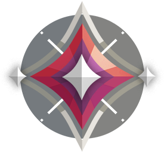

 

 

## LUNATIC5202

<strong>LUNATIC LAYMAN</strong> &nbsp; // &nbsp; CREATIVE DEVELOPER &nbsp; // &nbsp; DIGITAL WINDKEEPER

  <a href="https://github.com/Lunatic5202?tab=repositories">5 PUBLIC MISSIONS</a>
  &nbsp;·&nbsp;
  <a href="https://github.com/Lunatic5202">IMMORTAL LOADOUT</a>
  &nbsp;·&nbsp;
  <a href="https://github.com/Lunatic5202">BUILDING IN PUBLIC</a>

I build interfaces that feel alive, explore data until it tells a story, and prototype ambitious ideas before they have time to get boring. My work sits at the intersection of **front-end craft, AI/ML experiments, data exploration, and cinematic UI**.

## FEATURED MISSIONS

### [MAITRI](https://github.com/Lunatic5202/Maitri)

Real-time emotion detection from audio with a **FastAPI** backend, **Vite + React** frontend, lightweight NumPy preprocessing, and an audio classification endpoint.

`Python` `FastAPI` `React` `Vite` `NumPy`

### [DRISHTI MISSION CONSOLE](https://github.com/Lunatic5202/drishti-mission-cosmos)

An ISRO-inspired mission-control interface that simulates the path from raw photometry to signal processing, AI classification, model fitting, MCMC exploration, and final verdict.

`TypeScript` `React 19` `TanStack` `Tailwind` `Recharts`

### [JOURNEY TO DISCOVER](https://github.com/Lunatic5202/Journey-To-Discover)

A travel analytics project exploring Google review counts, popularity, ratings, budgets, zones, and hidden-gem destinations across India.

`R` `Shiny` `RMarkdown` `Data Analysis`

### [STYLE-IN-STORE](https://github.com/Lunatic5202/style-in-store)

A modern TypeScript/React storefront interface built around component-driven UI, fast iteration, and a clean visual system.

`TypeScript` `React` `Vite` `shadcn/ui` `Tailwind CSS`

### [BT--PROJECTS](https://github.com/Lunatic5202/bt--projects)

An active workspace for experimenting, building, and shipping the next mission.

## TECH LOADOUT

## COMBAT TELEMETRY

 

<a href="https://github.com/Lunatic5202?tab=repositories">REPOSITORIES</a>
&nbsp;&nbsp;·&nbsp;&nbsp;
<a href="https://github.com/Lunatic5202?tab=overview">CONTRIBUTIONS</a>
&nbsp;&nbsp;·&nbsp;&nbsp;
<a href="https://github.com/Lunatic5202">PROFILE</a>

## NEXT ROUND

I am exploring ways to make **data-heavy products feel cinematic**, **AI experiments feel approachable**, and **interfaces feel like places rather than pages**.

<h3>“Think you can keep up? Who am I kidding? You know you can't keep up.”</h3>
<h3>“Huh! Who are you all? The cleanup crew?”</h3>
<h3>“I got your backs. Just, y'know, from the front.”</h3>
<h3>“This is fun. Who needs training dummies when you have real dummies!”</h3>
<h3>“Woohoo, bum-bum-bum-bum!”</h3>
<h3>“Oh, my back hurts! Everyone's so heavy. What would you all do without me?”</h3>

---

&nbsp;&nbsp;&nbsp;&nbsp;

&nbsp;&nbsp;&nbsp;&nbsp;

&nbsp;&nbsp;&nbsp;&nbsp;

